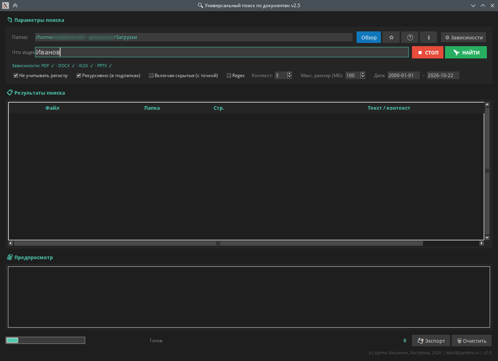

# docsearch_gui - УНИВЕРСАЛЬНЫЙ ПОИСК ПО ДОКУМЕНТАМ v2.5
### (c) AKSoft, 2026
### koscl@yandex.ru

## ЧТО ЭТО

Утилита для быстрого поиска текста по документам разных форматов
в указанной папке. Работает локально, интернет не нужен. Ничего
никуда не отправляет.

Поддерживает: PDF, DOCX, XLSX, PPTX, TXT и другие текстовые форматы.
Ищет по всем подпапкам (по умолчанию), кроме скрытых — скрытые
можно включить галочкой.

Всё необходимое для работы уже встроено в программу.
Дополнительно ничего устанавливать не нужно.




## БЫСТРЫЙ СТАРТ

  1. Запустите утилиту (двойной клик по файлу).
  2. Выберите папку: кнопка «Обзор» или введите путь вручную + Enter.
  3. Введите искомую фразу в поле «Что ищем».
  4. Нажмите Enter или кнопку «НАЙТИ».
  5. Двойной клик по совпадению — откроет файл.
  6. ПКМ по строке — меню с дополнительными действиями.


## ПОДДЕРЖИВАЕМЫЕ ФОРМАТЫ

```
  PDF          .pdf
  Word         .docx, .docm
  Excel        .xlsx, .xlsm, .xlsb
  PowerPoint   .pptx, .pptm
  Текст        .txt, .md, .rst, .csv,
               .log, .json, .xml,
               .html, .htm

  Не поддерживаются:
    .doc   (Word 2003 и старше) — сохраните как .docx
    .ppt   (PowerPoint 2003)    — сохраните как .pptx
    .xls   (Excel 2003)         — сохраните как .xlsx
```

## ПАНЕЛЬ ПАРАМЕТРОВ ПОИСКА

```
  Папка
      Папка, в которой искать. Можно:
        - ввести вручную и нажать Enter
        - выбрать через кнопку «Обзор»
        - взять из закладок (кнопка со звездой ⭐)
        - взять из истории (кнопка с часами 🕐)

  Кнопки в шапке:
      ⭐           — добавить текущую папку в закладки
      🕐           — открыть окно «История и закладки»
      ℹ           — окно «О программе»
      ⚙ Зависимости — окно с информацией о встроенных модулях

  Что ищем
      Искомая фраза. Enter — запустить поиск.
      Стрелка ↓ в поле — история последних поисковых фраз.

  Не учитывать регистр
      ☑ Включено по умолчанию. «Привет» и «привет» — одно и то же.
      ☐ Выключено — учитывать регистр.

  Рекурсивно (в подпапках)
      ☑ Включено по умолчанию — искать во всех подпапках.
      ☐ Выключено — только в указанной папке, без подпапок.

  Включая скрытые (с точкой)
      ☐ Выключено по умолчанию — скрытые файлы и папки
      (начинающиеся с точки) пропускаются.
      ☑ Включено — искать и в скрытых.

  Regex
      ☐ Выключено по умолчанию — обычный текстовый поиск.
      ☑ Включено — фраза воспринимается как регулярное выражение.
      Подробности — раздел 5.

  Контекст (строк)
      Сколько строк до и после совпадения показывать.
      0 — только строка с совпадением.
      1–10 — плюс N строк контекста.

  Макс. размер (МБ)
      Файлы больше указанного размера пропускаются.
      По умолчанию 100 МБ. Увеличьте для больших PDF.

  Дата
      Диапазон дат изменения файла в формате ГГГГ-ММ-ДД.
      По умолчанию: 2000-01-01 — сегодня.
```

## РЕЖИМ REGEX


  Галочка «Regex» — по умолчанию ВЫКЛЮЧЕНА.

```
  ☐ Выключена — ищется обычный текст, как есть. Скобки, точки,
    плюсы, звёздочки, вопросительные знаки — всё воспринимается
    буквально. «(черновик)» найдёт именно «(черновик)»,
    «цена: 100$» — «цена: 100$».

  ☑ Включена — введённая фраза воспринимается как регулярное
    выражение. Это мощный инструмент, но требует знания синтаксиса.
    Если regex некорректный — появится ошибка с описанием.
```

  КОГДА ИСПОЛЬЗОВАТЬ:

```
    Обычный поиск — когда нужно найти точную фразу:
      приказ Иванова
      Кашанин Артем Николаевич
      договор № 123

    Regex — когда нужен шаблон, а не точная фраза:
      приказ|распоряжение            — «приказ» ИЛИ «распоряжение»
      \d{4}                          — любое четырёхзначное число
      Иванов[ауыей]?                 — Иванов, Иванова, Иванову...
      ^Глава                        — строки, начинающиеся с «Глава»
      \bФЗ\b                         — «ФЗ» как отдельное слово
      \d{2}\.\d{2}\.\d{4}            — дата вида 21.10.2026

  ПРИМЕРЫ (галочка «Regex» включена):

    ┌────────────────────────────────┬─────────────────────────────────────┐
    │ Что ввели                      │ Что найдётся                        │
    ├────────────────────────────────┼─────────────────────────────────────┤
    │ приказ|распоряжение            │ «приказ» или «распоряжение»         │
    │ \d{4}                          │ любое 4-значное число               │
    │ \d{2}\.\d{2}\.\d{4}            │ дата 21.10.2026                     │
    │ ^Глава                         │ строки, начинающиеся с «Глава»      │
    │ Кашанин.*Артем                 │ «Кашанин», затем «Артем» на строке  │
    │ \bФЗ\b                         │ «ФЗ» как отдельное слово            │
    │ Иванов[ауыей]?                 │ Иванов, Иванова, Иванову, Ивановой  │
    │ [А-Я][а-я]+                    │ любое слово с большой буквы         │
    │ (приказ|распоряжение)\s+\d+    │ «приказ 123», «распоряжение 45»     │
    │ (?i)кашанин                    │ Кашанин, кашанин (без учёта регистра│
    │                                │ только для этой фразы)              │
    └────────────────────────────────┴─────────────────────────────────────┘

  ЧАСТЫЕ ОШИБКИ:

    (черновик)      — незакрытая скобка → ошибка
    [тест]          — не «слово тест», а «один из символов т, е, с»
    a.b             — точка = «любой символ», найдёт «axb», «a b»
    что?            — «что» + опциональная «т», найдёт «чт», «что»
    1+1             — «1» + «один или больше», найдёт «1», «11»
    $               — «конец строки», не «доллар»
    \.              — «точка как символ», а не «любой символ»
```

  Если ввели regex с ошибкой — программа покажет сообщение
  и предложит снять галочку «Regex».

  Если не уверены в синтаксисе — снимите галочку и ищите
  обычным текстом. Это безопаснее.


## РЕЗУЛЬТАТЫ ПОИСКА


Результаты сгруппированы по файлам:

```
  📄 имя_файла.docx       Папка/где/лежит       ← родитель (файл)
     ↳ 12                 текст совпадения      ← ребёнок (совпадение)
     ↳ 45                 ещё одно совпадение

  Файл         — имя файла.
  Папка        — путь, где лежит (обрезается с начала, если длинный).
  Стр.         — номер строки в файле.
  Текст        — строка с совпадением или контекст.

Цвета:
  - Бирюзовый жирный — родитель (файл)
  - Серый / тёмно-серый — чередование строк (zebra)
  - Бирюзовый фон в предпросмотре — найденная фраза

Что можно делать:
  - Двойной клик по файлу — свернуть/развернуть список совпадений
  - Двойной клик по совпадению — открыть файл в программе по умолчанию
  - Двойной клик по колонке «Папка» — открыть папку с выделением файла
  - ПКМ — контекстное меню (см. раздел 9)
  - Если у файла больше 5 совпадений — он автоматически свёрнут
```

## ПРЕДПРОСМОТР

Внизу окна — панель предпросмотра. Показывает текст выбранного
совпадения целиком. Если в тексте встречается искомая фраза —
она подсвечивается бирюзовым фоном.

Обновляется при клике на строку совпадения.


## ГОРЯЧИЕ КЛАВИШИ

```
  Enter (в поле «Что ищем»)   Запустить поиск
  Enter (в поле «Папка»)      Перейти к введённому пути

  ↓ в поле поиска             История поисковых фраз

  Ctrl+C                      Копировать выделенные строки:
                              - для файла: полный путь
                              - для совпадения: путь:строка + текст
  Ctrl+A                      Выделить всё в таблице результатов

  Двойной ЛКМ (по файлу)      Свернуть/развернуть
  Двойной ЛКМ (по совпадению) Открыть файл
  ПКМ (по строке)             Контекстное меню
```

## КОНТЕКСТНОЕ МЕНЮ (ПКМ)


Правый клик по любой строке результата:

```
  📂  Открыть файл       — открыть в программе по умолчанию
  📁  Открыть папку      — открыть папку с выделением файла
                           (Windows: Проводник, mac: Finder,
                            Linux: файловый менеджер)
  ────────────────────
  📋  Копировать путь    — полный путь к файлу в буфер
  📋  Копировать имя     — только имя файла
  📋  Копировать строку  — путь:строка + текст совпадения
```

## ЭКСПОРТ РЕЗУЛЬТАТОВ


Кнопка «💾 Экспорт». Доступные форматы:

```
  HTML    Красивая страница в тёмной теме. Открывается в браузере.
          Подходит для отправки коллегам.

  CSV     Таблица для Excel. Разделитель «;», кодировка UTF-8 с BOM
          (русские буквы отображаются корректно).

  JSON    Машиночитаемый формат для скриптов. Список объектов
          с полями file / folder / path / line / text.

  TXT     Простой текстовый отчёт. Удобно смотреть в любом редакторе.
```

## ИСТОРИЯ И ЗАКЛАДКИ

```
  Кнопка ⭐  — добавить текущую папку в закладки.
  Кнопка 🕐  — открыть окно «История и закладки».

  В окне:
    - двойной клик по записи — перейти к этой папке
    - кнопка «Перейти» — то же самое

  Хранится:
    - История: последние 20 папок поиска
    - Закладки: не ограничено
    - История фраз: последние 10 поисковых фраз (стрелка ↓ в поле)
```

## НАСТРОЙКИ

Настройки сохраняются автоматически при выходе.

Файл настроек:
```
  Windows:  C:\Users\<Имя>\.docsearch_settings.json
  Linux:    /home/<имя>/.docsearch_settings.json
  macOS:    /Users/<имя>/.docsearch_settings.json
```

Что сохраняется:
  - Последняя папка поиска
  - Закладки
  - История папок
  - История поисковых фраз
  - Макс. размер файла
  - Значение контекста
  - Галочки «Рекурсивно», «Включая скрытые», «Regex»

Чтобы сбросить настройки — удалите файл.


## ТРЕБОВАНИЯ

  Windows 7 и новее, Linux, macOS.

  Всё необходимое для работы уже включено в исполняемый файл.
  Дополнительно ничего устанавливать не нужно.

  Примечание: утилита не использует внешние программы для
  извлечения текста из PDF — всё работает через встроенные
  модули. Если какие-то форматы всё же не находятся —
  загляните в окно «⚙ Зависимости» (кнопка в шапке).


## ЛИЦЕНЗИЯ


  Программа абсолютно бесплатна.

  Распространяется «как есть» (as is), без каких-либо гарантий.

  Автор не несёт ответственности за любой ущерб, возникший в результате
  использования программы, включая потерю данных.


## СВЯЗЬ

- GitHub:    https://github.com/artemsoft2025/
- Telegram:  https://t.me/avhelpnew
- Email:     koscl@yandex.ru
